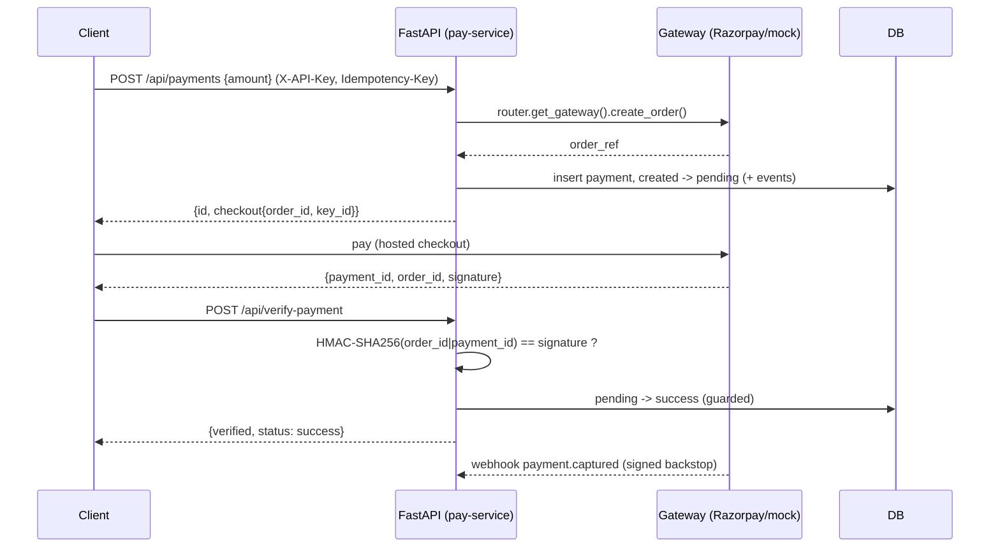
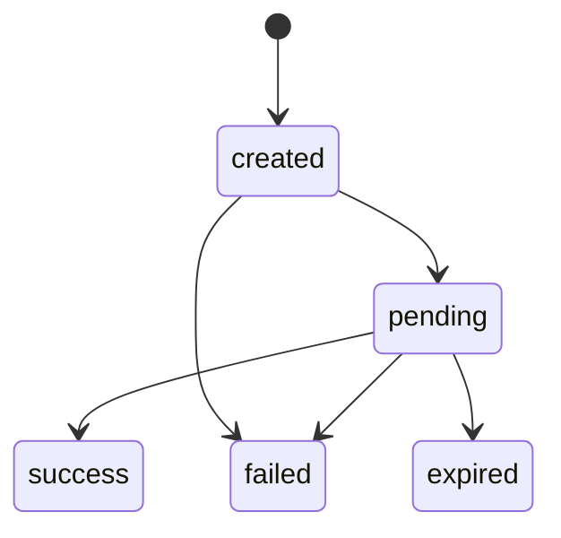

# pay-service — UPI payment orchestrator (FastAPI)

A production-shaped payment-orchestration service in **Python / FastAPI**. It models the part
of payments that actually matters in production — **idempotency, an enforced state machine,
gateway-signature verification, refunds, reconciliation, and an auditable event log** — and
fronts payment gateways through a **router** so adding a gateway is adding an adapter.

Runs with a **keyless mock gateway** out of the box; switches to **real Razorpay** when
credentials are set — no code change. (A sibling edge implementation runs live at
pay.dsremo.com.)

## Architecture





## API

| Method & path | Purpose |
|---|---|
| `POST /api/payments` | Create a payment. `Idempotency-Key` dedupes; `X-API-Key` required when auth is enabled. |
| `GET /api/payments/{id}` | Status + event history + refunds. |
| `POST /api/payments/{id}/refund` | Full or partial refund (`{amount?, reason?}`); guarded so total refunds can't exceed the captured amount. |
| `GET /api/refunds/{id}` | Refund status. |
| `POST /api/verify-payment` | Verify the checkout-callback signature (HMAC-SHA256). |
| `POST /api/webhook` | Gateway webhook; signature verified (timing-safe) before any state change. |
| `POST /api/payments/{id}/mock/{approve\|decline}` | Drive the keyless mock provider. |

## Design

- **Layered** — `gateways/` (router + adapters) · `service.py` (domain logic) · `models.py`
  (SQLAlchemy) · `schemas.py` (Pydantic) · `main.py` (HTTP) · `security.py` (auth).
- **Multi-gateway router** — `PaymentGateway` interface, `MockGateway`, `RazorpayGateway`,
  selected by `gateways/router.py`. Add a gateway = register an adapter.
- **Idempotency** — `Idempotency-Key` → unique column; a repeated key returns the original.
- **Enforced state machine** — transitions checked against an allow-list; each is a guarded
  `UPDATE … WHERE status = :from`, so a replayed webhook / racing callback is a no-op. Every
  transition is logged to `payment_events`.
- **Two-layer confirmation** — synchronous `/verify-payment` for instant UX; asynchronous
  signed **webhook** as the source of truth.
- **Refunds** — full/partial, with a guarded `refunded_amount` update preventing over-refund.
- **API-key auth** — `X-API-Key` enforced on writes when `PAY_API_KEYS` is set.
- **Lazy expiry** — a stale pending payment expires on read, no cron needed.

## Run

```bash
python -m venv .venv && . .venv/bin/activate
pip install -r requirements.txt
uvicorn app.main:app --reload          # SQLite by default; OpenAPI at /docs
```

Config via env: `DATABASE_URL` (defaults to SQLite; set a Postgres URL for prod),
`PAY_API_KEYS` (comma-separated; auth off if unset), and `RAZORPAY_KEY_ID` /
`RAZORPAY_KEY_SECRET` / `RAZORPAY_WEBHOOK_SECRET` to switch from mock to real Razorpay.
Secrets come only from the environment — never committed.

## Roadmap (production hardening)

Multi-gateway **failover routing** (route by cost/success-rate), split/marketplace settlement,
saga orchestration for long flows, Alembic migrations, scheduled reconciliation against
settlement reports, disputes/chargebacks, and async SQLAlchemy for high concurrency.
